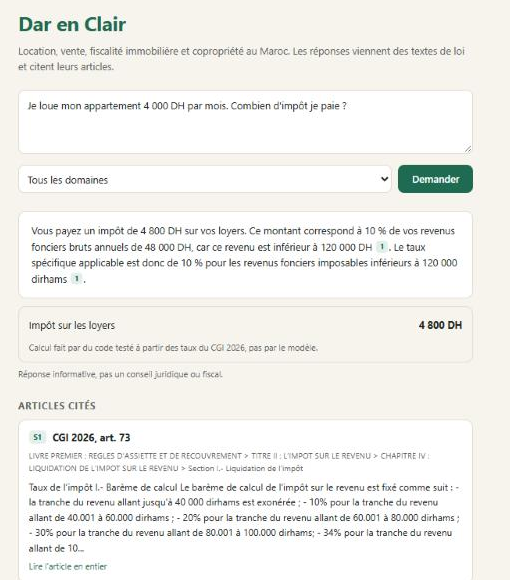
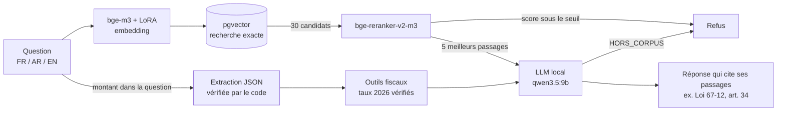

<div align="center">

# Dar en Clair

**Un assistant de questions-réponses sur le droit immobilier marocain.**<br>
Il cite les articles exacts sur lesquels il s'appuie, refuse quand les textes ne disent rien, et confie les montants d'impôt à du code testé.

[](https://github.com/CrimsonAzul/dar-en-clair/actions/workflows/ci.yml)


-333333)

[English](README.md) | **Français**



</div>

> Réponses informatives, pas un conseil juridique ou fiscal.

## Pourquoi

Louer, acheter, vendre ou payer les impôts d'un bien au Maroc relève de sept textes, éparpillés dans des PDF en français et en arabe. Les gens posent leurs questions en français courant, en darija ou en anglais. Un chatbot qui invente un numéro d'article ou un montant d'impôt fait pire que pas de chatbot du tout.

D'où des règles simples : répondre uniquement à partir des textes officiels, montrer d'où vient chaque affirmation, le dire quand les textes ne couvrent pas la question, et mesurer tout cela honnêtement.

## Ce qu'il fait

- **Cherche dans 7 textes officiels** (1 217 articles, 1 523 morceaux, en français et en arabe) : baux d'habitation et commerciaux, droits réels, notariat, copropriété, Code général des impôts 2026 et fiscalité locale.
- **Cite ses sources.** Le modèle reçoit des passages numérotés [S1] à [S5] et les cite par leur numéro ; l'application les transforme en références comme « Loi 67-12, art. 34 ». Un numéro qui n'a jamais été fourni compte comme citation inventée (zéro à ce jour).
- **Refuse en deux temps :** un seuil sur le score du reranker, choisi sur le jeu dev, puis le modèle lui-même, qui doit répondre `HORS_CORPUS` quand les passages ne répondent pas à la question.
- **Calcule les impôts avec du code, pas avec le modèle :** impôt sur les loyers, impôt sur le profit d'une vente, droits d'enregistrement. Chaque taux vient du PDF officiel du CGI 2026, avec son article et sa page. Le modèle remplit seulement un formulaire JSON avec les montants lus dans la question ; le code les vérifie, fait le calcul et ajoute le montant si la réponse l'oublie.
- **Tourne sur un ordinateur portable :** embeddings affinés sur un GPU de 6 Go, LLM local via Ollama, pgvector dans Docker. Rien ne quitte la machine (Gemini est optionnel).

## Résultats

Mesurés sur un jeu de test mis de côté, lancé une seule fois par configuration, après que chaque choix a été fait sur un jeu dev séparé.

| Jeu de test | Résultat |
|---|---|
| Réponses utiles (citent au moins un article attendu) | **35 / 51**, contre 23 / 51 avec la version précédente |
| Questions pièges refusées (la bonne réponse est « non couvert ») | 7 / 9 |
| Citations inventées | 0 |
| Calculs d'impôt corrects (jeu dev, 4 questions chiffrées) | 4 / 4 |
| recall@5 de la recherche livrée | 0,578 [0,464 ; 0,693] |
| Gain de recall@5 dû au fine-tuning LoRA | +0,078 [+0,020 ; +0,148] |

Méthode : 100 questions annotées au niveau de l'article, 40 pour le dev (tous les réglages) et 60 pour le test, intervalles de confiance à 95 % par bootstrap. Un second jeu mis de côté, de 35 questions écrites hors du projet, teste le langage courant et la darija. Tableaux complets, comparaison des modèles et méthode : [docs/evaluation.md](docs/evaluation.md) et [eval/README.md](eval/README.md).

## Limites, sans détour

- **La darija n'est pas encore gérée.** Aucune des 12 questions en darija du jeu externe n'obtient de réponse : le modèle de recherche la comprend à peine.
- **Sur un langage vraiment courant, le reranker nuit.** Sur le jeu externe, il divise le recall@5 par deux, alors que sur le jeu de test il ne changeait rien de mesurable.
- **Le jeu de questions principal a été rédigé avec un assistant IA**, puis vérifié contre les textes de loi. Il manque encore un jeu de questions de vrais usagers, recopiées sans retouche.
- **Petits échantillons :** 51 questions de test, donc des intervalles larges.
- **Pas encore lancé :** le chemin Gemini, l'image Docker de l'API, un juge de la fidélité des réponses.

## Comment ça marche



Choix de conception, chacun appuyé sur une mesure :

- **Pas de BM25 dans le chemin livré.** Il était prévu (BM25 maison, fusion RRF). Sur dev, BM25 seul atteignait un recall@5 de 0,245 contre 0,647 pour la recherche dense, et sur test la fusion dégradait nettement les résultats (recall@5 -0,144). Le code reste comme référence mesurée.
- **Fine-tuning LoRA de bge-m3** sur 6 448 questions synthétiques produites par un LLM local : 56 minutes sur le GPU de 6 Go d'un portable, 2,8 Go de VRAM au maximum. recall@5 +0,12 sur la validation synthétique, +0,078 sur le jeu de test : plus faible, comme prévu.
- **Modèle local choisi sur dev** parmi cinq modèles libres (Qwen 2.5 et 3.5, Command R7B, Ministral 3), avec une règle écrite avant de voir les résultats.
- **Calculs décidés par le code.** Les petits modèles oubliaient les outils ou prenaient le mauvais. Aucune exonération n'est déduite par un outil : sur dev, un modèle avait appliqué celle de l'habitation principale à la vente d'un terrain.
- **Un texte, une langue, sans traduction.** Chaque loi est indexée dans sa meilleure version (la loi 47-06 consolidée n'existe qu'en arabe) ; les modèles multilingues font le pont entre les langues.
- **PDF difficiles :** notes de bas de page repérées par la taille de police, OCR pour les pages scannées, ligatures arabes cassées réparées.

## Démarrage rapide

```bash
python -m venv .venv && .venv\Scripts\activate
pip install torch --index-url https://download.pytorch.org/whl/cu126   # ou /cpu
pip install -e ".[ml,dev]"
cp .env.example .env                 # GEMINI_API_KEY, ou un modèle local : ollama pull qwen3.5:9b
docker compose up -d db
python -m darenclair.ingest.corpus   # découpe les PDF listés dans config/corpus.yaml
python -m darenclair.ingest.indexer  # calcule les vecteurs et remplit pgvector
uvicorn darenclair.api.main:app --port 8000 --env-file .env
cd web && npm install && npm run dev # interface sur http://localhost:3000
```

Tests : `pytest` (77 tests, sans GPU ni base de données). L'adaptateur LoRA n'est pas dans le dépôt : le recréer avec les commandes de [docs/evaluation.md](docs/evaluation.md), ou mettre `ADAPTATEUR=` pour utiliser bge-m3 de base.

## Technologies

| Couche | Outils |
|---|---|
| Recherche | bge-m3 affiné avec LoRA (PEFT, sentence-transformers), bge-reranker-v2-m3, PostgreSQL 16 + pgvector |
| Génération | Ollama avec qwen3.5:9b (local), ou Gemini |
| Backend | Python, FastAPI |
| Interface | Next.js 16, React 19, TypeScript |
| Documents | PyMuPDF, OCR Tesseract |
| Qualité | pytest, ruff, GitHub Actions |

## Organisation du code

```
src/darenclair/
  ingest/       lecture des PDF, OCR, corrections de l'arabe, découpage, indexation pgvector
  retrieval/    recherche dense, reranker, seuil de refus (BM25 et RRF gardés comme références)
  generation/   prompt, citations, calculs décidés par le code, clients Ollama et Gemini
  tools/        calculateur fiscal, taux dans config/fiscal_2026.yaml
  finetune/     questions synthétiques, entraînement et évaluation du LoRA
  evaluation/   métriques, bancs d'essai de la recherche et de la génération
  api/          application FastAPI
web/            interface Next.js
eval/           jeux de questions et leur construction
docs/           résultats détaillés, capture d'écran
```

## Feuille de route

- [x] Découpage au niveau de l'article de 7 textes, en français et en arabe
- [x] Fine-tuning LoRA, recherche dense, reranker, seuil de refus
- [x] Réponses citées, calculs décidés par le code, API et interface
- [x] Évaluation sur dev, test et un jeu externe, avec intervalles de confiance
- [ ] Gérer la darija : réécrire la question en français avant la recherche, à régler sur un jeu dev qui en contient
- [ ] Un jeu de questions de vrais usagers, recopiées sans retouche
- [ ] Un juge de la fidélité des réponses, vérifié sur 20 réponses notées à la main

## Auteur

**El Mehdi El Azzouzi**, élève ingénieur en 5e année. J'ai construit Dar en Clair comme projet de portfolio pendant ma recherche de stage de fin d'études (PFE). Questions et retours bienvenus via les issues GitHub.
