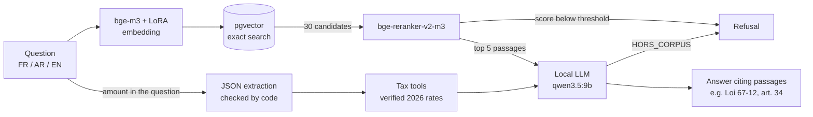

<div align="center">

# Dar en Clair

**A question answering assistant on Moroccan real estate law.**<br>
It cites the exact articles it relies on, refuses when the law texts are silent, and leaves tax amounts to tested code.

[](https://github.com/CrimsonAzul/dar-en-clair/actions/workflows/ci.yml)


-333333)

**English** | [Français](README.fr.md)


</div>

> Answers are informative only, not legal or tax advice.

## Why

Renting, buying, selling and paying property taxes in Morocco is governed by seven texts, spread across French and Arabic PDFs. People ask about them in everyday French, Darija or English. A chatbot that invents an article number or a tax amount is worse than no chatbot at all.

So the rules here are simple: answer only from the official texts, show where every claim comes from, say so when the texts do not cover the question, and measure all of it honestly.

## What it does

- **Searches 7 official texts** (1,217 articles, 1,523 chunks, French and Arabic): residential and commercial leases, property law, notaries, co-ownership, the 2026 tax code and local taxes.
- **Cites its sources.** The model sees numbered passages [S1] to [S5] and cites them by number; the app turns them into references such as "Loi 67-12, art. 34". A number that was never provided counts as an invented citation (zero so far).
- **Refuses in two steps:** a threshold on the reranker score, chosen on the dev set, then the model itself, which must answer `HORS_CORPUS` when the passages do not answer the question.
- **Computes taxes with code, not with the model:** rental income tax, profit tax on a sale, registration duties. Every rate comes from the official 2026 tax code PDF, with its article and page. The model only fills in a JSON form with the amounts it read in the question; the code checks them, runs the calculation and adds the amount if the answer leaves it out.
- **Runs on a laptop:** embeddings fine-tuned on a 6 GB GPU, a local LLM through Ollama, pgvector in Docker. Nothing leaves the machine (Gemini is optional).

## Results

Measured on a held-out test set, run once per configuration, after every choice was made on a separate dev set.

| Test set | Result |
|---|---|
| Useful answers (cite at least one expected article) | **35 / 51**, up from 23 / 51 with the previous setup |
| Trap questions refused (the right answer is "not covered") | 7 / 9 |
| Invented citations | 0 |
| Tax calculations correct (dev set, 4 questions with amounts) | 4 / 4 |
| Retrieval recall@5, shipped pipeline | 0.578 [0.464, 0.693] |
| Recall@5 gain from the LoRA fine-tune | +0.078 [+0.020, +0.148] |

How it was measured: 100 questions annotated at the article level, 40 for dev (all tuning) and 60 for test, 95 % confidence intervals by bootstrap. A second, held-out set of 35 questions written outside the project tests everyday wording and Darija. Full tables, model comparison and method: [docs/evaluation.md](docs/evaluation.md) (in French) and [eval/README.md](eval/README.md).

## Honest limits

- **Darija is not handled yet.** None of the 12 Darija questions in the external set gets an answer: the search model barely understands it.
- **On everyday wording, the reranker hurts.** On the external set it halves recall@5, while on the test set it changed nothing measurable.
- **The main question set was drafted with an AI assistant**, then checked against the law texts. A set of questions from real users, copied without edits, is still missing.
- **Small samples:** 51 test questions, so the intervals are wide.
- **Not run yet:** the Gemini path, the Docker image for the API, a judge for answer faithfulness.

## How it works



Design choices, each backed by a measurement:

- **No BM25 in the shipped path.** It was planned (custom BM25, RRF fusion). On dev, BM25 alone reached recall@5 0.245 against 0.647 for dense search, and on test the fusion significantly hurt (recall@5 -0.144). The code stays as a measured baseline.
- **LoRA fine-tune of bge-m3** on 6,448 synthetic questions from a local LLM: 56 minutes on a 6 GB laptop GPU, 2.8 GB VRAM peak. Recall@5 +0.12 on synthetic validation, +0.078 on the test set: smaller, as expected.
- **Local model chosen on dev** among five free models (Qwen 2.5 and 3.5, Command R7B, Ministral 3), with a rule written down before seeing the results.
- **Calculations decided by code.** Small models forgot the tools or picked the wrong one. Exemptions are never inferred by a tool: on dev, one model applied the main-home exemption to the sale of a plot of land.
- **One text, one language, no translation.** Each law is indexed in its best version (the consolidated local tax law only exists in Arabic); the multilingual models bridge the languages.
- **Hard PDFs:** footnotes found by font size, OCR for scanned pages, broken Arabic ligatures repaired.

## Quick start

```bash
python -m venv .venv && .venv\Scripts\activate
pip install torch --index-url https://download.pytorch.org/whl/cu126   # or /cpu
pip install -e ".[ml,dev]"
cp .env.example .env                 # GEMINI_API_KEY, or a local model: ollama pull qwen3.5:9b
docker compose up -d db
python -m darenclair.ingest.corpus   # parse the PDFs listed in config/corpus.yaml
python -m darenclair.ingest.indexer  # embed and index the chunks in pgvector
uvicorn darenclair.api.main:app --port 8000 --env-file .env
cd web && npm install && npm run dev # interface on http://localhost:3000
```

Tests: `pytest` (77 tests, no GPU or database needed). The LoRA adapter is not in the repo: rebuild it with the commands in [docs/evaluation.md](docs/evaluation.md), or set `ADAPTATEUR=` to use base bge-m3.

## Tech stack

| Layer | Tools |
|---|---|
| Retrieval | bge-m3 fine-tuned with LoRA (PEFT, sentence-transformers), bge-reranker-v2-m3, PostgreSQL 16 + pgvector |
| Generation | Ollama with qwen3.5:9b (local), or Gemini |
| Backend | Python, FastAPI |
| Interface | Next.js 16, React 19, TypeScript |
| Documents | PyMuPDF, Tesseract OCR |
| Quality | pytest, ruff, GitHub Actions |

## Project structure

```
src/darenclair/
  ingest/       PDF parsing, OCR, Arabic fixes, chunking, pgvector indexing
  retrieval/    dense search, reranker, refusal threshold (BM25 and RRF kept as baselines)
  generation/   prompt, citations, code-driven tax calculations, Ollama and Gemini clients
  tools/        tax calculator, rates in config/fiscal_2026.yaml
  finetune/     synthetic questions, LoRA training and evaluation
  evaluation/   metrics, retrieval and generation benchmarks
  api/          FastAPI app
web/            Next.js interface
eval/           question sets and how they were built
docs/           detailed results (in French), screenshot
```

## Roadmap

- [x] Article-level parsing of 7 texts, French and Arabic
- [x] LoRA fine-tune, dense search, reranker, refusal threshold
- [x] Cited answers, code-driven tax calculations, API and interface
- [x] Evaluation on dev, test and an external set, with confidence intervals
- [ ] Handle Darija: rewrite the question in French before searching, tuned on a dev set that includes Darija
- [ ] A set of real user questions, copied without edits
- [ ] A judge for answer faithfulness, checked against 20 hand-graded answers

## Author

**El Mehdi El Azzouzi**, 5th-year engineering student. I built Dar en Clair as a portfolio project while looking for an end-of-studies internship (PFE). Questions and feedback are welcome through GitHub issues.
