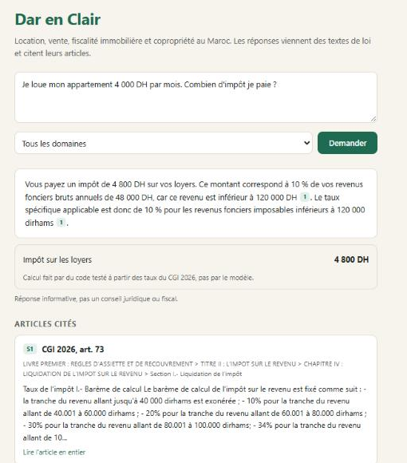

# Dar en Clair

**In English.** Dar en Clair is a question answering assistant on Moroccan real estate law: renting, buying and selling, property tax and co-ownership. It searches 7 official texts (1,523 article-level chunks, French and Arabic), answers with numbered citations that link back to the exact articles, refuses when the texts do not cover the question, and leaves tax amounts to tested Python code instead of the language model. Retrieval is bge-m3 with a LoRA adapter I fine-tuned on a 6 GB laptop GPU, exact search in pgvector, then the bge-reranker-v2-m3 cross-encoder. The main numbers come from a separate 100-question set (drafted with an AI assistant, then checked against the law texts) split into dev, used for every tuning decision, and test, run once per configuration, with bootstrap confidence intervals. On the 51 test questions that have a source, the shipped pipeline (dense + reranker) reaches recall@5 0.578 and MRR 0.608. At this sample size the reranker's gain over dense search alone is not significant, and fusing BM25 through RRF clearly hurts (recall@5 -0.144). The answering model runs locally: qwen3.5:9b, picked among five free models on dev with a rule fixed before seeing its results. Tax amounts are decided and computed by code, not left to the model. On the test set it gives a useful answer (one that cites at least one expected article) to 35 of 51 questions, up from 23 with the previous setup, refuses 7 of 9 trap questions and never cites a passage that does not exist. On 35 questions written outside the project, including Moroccan Darija, it does poorly: Darija is not handled yet, and that is stated as such. Stack: Python, PyTorch, sentence-transformers, PEFT, PostgreSQL + pgvector, FastAPI, Next.js, Gemini or a local model through Ollama. Answers are informative only, not legal advice.

---

Assistant de questions-reponses sur l'immobilier au Maroc : location, vente, fiscalite immobiliere et copropriete. Il repond en citant les articles de loi utilises, refuse quand le corpus ne couvre pas la question, et confie les calculs d'impots a du code Python teste plutot qu'au modele.

> Reponses informatives, pas un conseil juridique ou fiscal.



## Corpus

| Domaine | Textes |
|---|---|
| Location | Loi 67-12 (baux d'habitation et professionnels), Loi 49-16 (baux commerciaux) |
| Vente | Loi 39-08 (Code des droits reels), Loi 32-09 (notariat) |
| Fiscalite | Code General des Impots 2026, Loi 47-06 (fiscalite locale, version consolidee 2021 en arabe) |
| Copropriete | Loi 18-00 |

1 217 articles, 1 523 chunks (193 en arabe). Sources et versions : [data/raw/SOURCES.md](data/raw/SOURCES.md).

## Architecture

```
PDF -> nettoyage (OCR si scan) -> 1 chunk par article (+ morceaux de 350 mots si long)
       texte indexe = "Loi > Titre > Chapitre > Article N" + contenu

question -> bge-m3 + LoRA -> pgvector (recherche exacte) -> 30 candidats
                                                               |
                              reranker bge-reranker-v2-m3 <----+
                                         |
                    score max < seuil ? -- oui --> refus explicite
                                         | non
                           5 passages numerotes [S1]..[S5]
                                         |
   chiffre dans la question ? -> extraction JSON a format impose (LLM)
                              -> montants verifies par le code -> outil fiscal (Python)
                                         |
                       LLM --> reponse + citations [S2] (+ montant ajoute s'il l'oublie)
                                         -> "Loi 67-12, art. 34"
              LLM qui juge les passages insuffisants -> HORS_CORPUS -> refus
```

Choix et raisons :
- **Contexte dans le chunk** : un article seul ("le preneur doit...") est ambigu ; le chemin Titre > Chapitre aide la recherche.
- **LoRA sur bge-m3** : 6 448 questions synthetiques, entrainement sur un GPU de 6 Go (detail plus bas). Gain significatif sur le jeu de test (recall@5), plus faible que sur les questions synthetiques.
- **Pas de BM25 dans le chemin livre.** Je l'avais prevu (BM25 maison avec un raciniseur leger, fusion RRF). Mesure sur le jeu dev : BM25 seul trouve peu de choses avec des questions en langage courant (recall@5 0.245 contre 0.647 en dense), et la fusion RRF degrade l'ordre des candidats denses. Le code reste dans le depot et ces configurations sont mesurees dans le tableau.
- **Reranker sur les 30 candidats denses** : la variante la plus simple et la meilleure sur dev (reclasser l'union dense + BM25 donnait un MRR plus bas). Sur test, son gain sur le dense seul n'est pas significatif ; son score sert aussi au refus.
- **Refus a deux niveaux** : un seuil sur le score du reranker, choisi sur dev, puis le LLM qui doit repondre HORS_CORPUS si les passages ne repondent pas. Un LLM seul repond presque toujours quelque chose.
- **Citations par numero de passage** ([S2]) puis conversion en article : pas de reference inventee ou mal recopiee. Un numero hors liste est compte comme citation inventee.
- **Calculs dans du code, et decides par le code** : taux dans `config/fiscal_2026.yaml`, relus dans le PDF du CGI avec l'article et la page. Le modele ne choisit plus s'il faut un outil : sur dev, les petits modeles l'oubliaient ou prenaient le mauvais. Il remplit seulement un JSON a format impose (quel calcul, quels montants) ; le code verifie que chaque montant figure dans la question, fait les conversions (loyer mensuel x 12), appelle l'outil et ajoute le montant si la reponse l'oublie. Les exonerations ne sont jamais deduites par un outil : sur dev, un modele avait applique celle de l'habitation principale a la vente d'un terrain.
- **Corpus multilingue sans traduction** : chaque texte est indexe dans sa meilleure version (la loi 47-06 consolidee n'existe qu'en arabe). bge-m3 et le reranker sont multilingues : une question en francais, arabe ou anglais trouve l'article quelle que soit sa langue. Le LLM repond dans la langue de la question ; l'article cite est montre tel quel.
- **PDF difficiles** : notes de bas de page reperees par la taille de police, en-tetes par leur position, sommaires et annexes ecartes, OCR Tesseract pour les scans, ligatures arabes lam-alef reparees grace a la largeur nulle de l'alef dans le glyphe.

## Lancer

```bash
python -m venv .venv && .venv\Scripts\activate
pip install torch --index-url https://download.pytorch.org/whl/cu126   # ou /cpu
pip install -e ".[ml,dev]"
cp .env.example .env                 # GEMINI_API_KEY, sinon Ollama en local (ollama pull qwen3.5:9b)
docker compose up -d db
python -m darenclair.ingest.corpus   # decoupe les PDF de data/raw selon config/corpus.yaml
                                     # PDF scannes : OCR Tesseract + modele fra de tessdata_best dans .tessdata/
python -m darenclair.ingest.indexer  # vecteurs bge-m3 + LoRA dans pgvector (1 min sur RTX 3060)
uvicorn darenclair.api.main:app --port 8000 --env-file .env
cd web && npm install && npm run dev # interface sur http://localhost:3000
pytest
```

Changer de LLM local : `OLLAMA_MODEL` dans `.env` (ou dans le terminal avant de lancer l'API ou une evaluation), par exemple sous PowerShell :

```powershell
$env:LLM_PROVIDER="ollama"; $env:OLLAMA_MODEL="qwen2.5:7b"   # plus rapide, refuse plus souvent
uvicorn darenclair.api.main:app --port 8000
python -m darenclair.evaluation.generation --split dev   # memes mesures que le tableau, pour ce modele
```

La reflexion des modeles qui en ont une (Qwen3.5) est coupee par defaut ; `OLLAMA_THINK=1` pour la garder.

L'adaptateur LoRA (`models/bge-m3-lora`) n'est pas versionne : le recreer avec les commandes du fine-tuning, ou lancer l'indexation et l'API avec `ADAPTATEUR=` pour bge-m3 de base. Le seuil de refus est dans `config/recherche.yaml` (ecrit par l'evaluation sur dev).

## Evaluation

Methode dans [eval/README.md](eval/README.md) : 100 questions annotees au niveau article (60 simples, 25 sur plusieurs textes, 15 pieges dont la bonne reponse est un refus), 40 en dev pour tous les reglages, 60 en test lances une seule fois par configuration. Metriques au niveau article (deux morceaux du meme article comptent une fois), intervalles a 95 % par bootstrap, ecarts entre configurations par bootstrap apparie.

Les questions ont ete ecrites avec un assistant IA puis relues contre les textes, pas par de vrais utilisateurs : c'est la principale limite de ces chiffres.

### Recherche (jeu test, 51 questions avec source)

| Configuration | recall@5 | recall@10 | MRR |
|---|---|---|---|
| BM25 | 0.225 [0.131, 0.330] | 0.291 | 0.229 [0.135, 0.334] |
| Dense (bge-m3 + LoRA, pgvector) | 0.631 [0.529, 0.735] | 0.686 | 0.568 [0.462, 0.678] |
| Hybride (RRF dense + BM25) | 0.487 [0.366, 0.605] | 0.572 | 0.456 [0.350, 0.565] |
| **Dense + reranker (chemin livre)** | 0.578 [0.464, 0.693] | 0.699 | 0.608 [0.498, 0.713] |
| Hybride + reranker | 0.595 [0.480, 0.706] | 0.683 | 0.597 [0.484, 0.704] |
| Union dense et BM25 + reranker | 0.569 [0.454, 0.686] | 0.683 | 0.585 [0.476, 0.694] |

Ecarts apparies sur test (IC a 95 %) :
- dense contre BM25 : recall@5 +0.405 [+0.291, +0.523], significatif ;
- hybride contre dense : recall@5 -0.144 [-0.225, -0.069], significatif. Ajouter BM25 par RRF fait sortir du top 5 des articles que le dense trouvait ;
- dense + reranker contre dense : recall@5 -0.052 [-0.124, +0.023], MRR +0.040 [-0.067, +0.140], non significatifs. Sur 51 questions, le reranker n'apporte pas de gain mesurable a la recherche dense avec LoRA ;
- hybride + reranker contre hybride : MRR +0.141 [+0.049, +0.235], significatif. Le reranker repare surtout ce que la fusion a abime.

Le chemin livre a ete choisi sur dev (34 questions), avant de lancer le test : dense + reranker y avait le meilleur MRR (0.689, contre 0.650 pour hybride + reranker et 0.636 pour dense seul), sans ecart significatif. Sur test, dense seul fait aussi bien. Je n'ai rien change apres avoir vu ces chiffres : ce serait regler sur le test.

### Refus et generation (jeu test, 60 questions) : version actuelle

LLM local via Ollama (pas de cle Gemini sur la machine de test) : qwen3.5:9b, calculs decides par le code. Modele et methode choisis sur dev avant ce passage, avec une regle fixee avant de voir ses resultats (section "Quel LLM local ?"). Un seul passage sur test.

| Jeu test | Avant : qwen2.5:7b | Maintenant : qwen3.5:9b, calculs par le code |
|---|---|---|
| Reponses utiles (au moins un article attendu cite) | 23 / 51 | **35 / 51** |
| Questions normales repondues | 29 / 51 | 48 / 51 |
| Pieges refuses (seuil du reranker + LLM) | 8 / 9 | 7 / 9 |
| Precision des citations, sur les reponses donnees | 0.609 [0.460, 0.753] | 0.434 [0.330, 0.542] |
| Rappel des citations, sur les reponses donnees | 0.678 [0.523, 0.816] | 0.583 [0.465, 0.701] |
| Citations inventees | 0 | 0 |
| Reponses sans aucune citation | 1 / 29 | 0 / 48 |
| Questions en arabe / en anglais repondues | 3/7, 1/5 | 6/7, 4/5 |

Le 9B repond a presque tout, ce qui fait monter les reponses utiles de 23 a 35. La precision des citations baisse parce qu'il repond aussi aux questions difficiles que l'ancien modele refusait. Il laisse passer un piege de plus. Les 4 calculs de dev passent par le bon outil avec les deux modeles depuis que le code les decide (le test n'a pas de question chiffree).

### Refus et generation (jeu test) : version precedente, qwen2.5:7b

C'est un petit modele : ces chiffres sont un plancher. Le meme script tourne avec Gemini des qu'une cle est dans `.env`.

| | Jeu test |
|---|---|
| Pieges refuses par le seuil du reranker seul (seuil 0.0077 choisi sur dev) | 1 / 9 |
| Pieges refuses au total (seuil + LLM qui repond HORS_CORPUS) | 8 / 9 |
| Questions normales repondues | 29 / 51 |
| Precision des citations (articles cites qui sont attendus) | 0.609 [0.460, 0.753] |
| Rappel des citations (articles attendus qui sont cites) | 0.678 [0.523, 0.816] |
| Citations inventees ([S9] alors qu'il n'y a que 5 passages) | 0 |
| Reponses sans aucune citation | 1 / 29 |

Ce que ca montre :
- Le seuil sur le score du reranker refuse peu de pieges : les pieges proches d'un texte du corpus ont des scores aussi hauts que de vraies questions. C'est le LLM qui fait l'essentiel du tri. Le seul piege non refuse (q090, aide de l'Etat pour un premier logement) tombe sur l'article 247 du CGI (logement social et a faible valeur immobiliere) : le modele a presente ces regimes fiscaux comme s'ils etaient l'aide directe.
- Le defaut principal est l'exces de prudence : 20 questions normales refusees par le LLM. Pour 9 d'entre elles, aucun article attendu n'etait dans les 5 passages (refus justifie, la faute est a la recherche) ; pour les 11 autres, l'article etait la. Les questions sur plusieurs textes sont les plus touchees (12 refusees sur 15) : le modele refuse des qu'une partie de la question n'est pas couverte.
- Les questions en arabe et en anglais passent mal avec ce modele : 3 sur 7 et 1 sur 5 repondues sur test, contre 25 sur 39 en francais. La recherche multilingue n'est pas seule en cause : qwen2.5:7b refuse plus souvent et repond parfois en francais a une question en anglais. Sur dev, qwen3.5:9b repond aux 4 questions en arabe (comparaison des modeles plus bas).
- Pas de juge LLM pour la fidelite des reponses : il faudrait d'abord le valider sur 20 reponses notees a la main. En lisant les reponses, on trouve encore des erreurs de fond (par exemple une augmentation de loyer "plus frequente si les parties sont d'accord", que l'article 32 de la loi 67-12 interdit).

Calculs (jeu dev, les 4 questions chiffrees y sont toutes) : apres une revision du prompt sur dev, le modele appelle le bon outil pour les 4 (4 800, 36 000, 30 000 et 40 000 DH, tous corrects). Avant la revision, il calculait lui-meme ou se trompait d'outil : aucun des 4 montants ne sortait du bon outil. Un calcul compte comme correct seulement si un outil a renvoye le montant attendu et que ce montant est dans la reponse (le nombre seul dans le texte peut etre un hasard). La revision (qui paie quel impot dans la description des outils, verifier que les passages parlent de la meme situation, HORS_CORPUS accepte n'importe ou dans la reponse) a ete faite une seule fois, sur dev : pieges refuses de 4/6 a 6/6, questions normales repondues de 28/34 a 24/34.

### Quel LLM local ? (jeu dev, 40 questions)

Cinq modeles libres, avec le meme prompt, les memes outils et les memes passages, sur le jeu dev seulement : le test reste reserve au modele retenu. Tous tournent via Ollama sur le GPU de 6 Go (la reflexion des Qwen3.5 est coupee).

| Modele | Pieges refuses | Questions normales repondues | Precision des citations | Rappel des citations | Calculs corrects | Arabe / anglais repondues | s par question |
|---|---|---|---|---|---|---|---|
| qwen2.5:7b | 6/6 | 24/34 | 0.44 | 0.65 | 4/4 | 2/4, 3/3 | 10 |
| qwen3.5:4b | 6/6 | 23/34 | 0.46 | 0.75 | 1/4 | 2/4, 3/3 | 7.5 |
| qwen3.5:9b | 4/6 | 32/34 | 0.49 | 0.70 | 1/4 | 4/4, 3/3 | 27 |
| command-r7b | 5/6 | 25/34 | 0.09 | 0.22 | 0/4 | 3/4, 1/3 | 32 |
| ministral-3:8b | 5/6 | 18/34 | 0.60 | 0.68 | 0/4 | 4/4, 2/3 | 29 |
| qwen2.5:7b, calculs par le code | 6/6 | 25/34 | 0.48 | 0.51 | 4/4 | 2/4, 3/3 | 9 |
| **qwen3.5:9b, calculs par le code (retenu)** | 5/6 | 34/34 | 0.41 | 0.65 | 4/4 | 4/4, 3/3 | 30 |

Lecture :
- Sans aide, aucun ne gagne partout : qwen2.5:7b refuse tous les pieges et fait les 4 calculs, mais refuse 10 questions sur 34 ; qwen3.5:9b repond a presque tout, arabe compris, mais n'appelle presque jamais les outils de calcul.
- Une fois les calculs decides par le code, cette faiblesse du 9B disparait (4 sur 4). Regle fixee avant de voir ses resultats : le 9B est retenu s'il fait les 4 calculs, refuse au moins 5 pieges sur 6 et repond a plus de questions que le 7B. Il remplit les trois. Il est aussi le plus lent : une partie du modele ne tient pas dans les 6 Go et tourne sur le processeur.
- Premier essai de l'extraction : le 9B laissait tomber le prix pour les droits d'enregistrement (2 calculs sur 4). Corrige sur dev en rendant tous les champs du JSON obligatoires, puis les deux modeles ont ete relances.
- ministral-3:8b cite le plus juste, mais refuse plus de la moitie des questions en francais (15 sur 27).
- command-r7b ecrit "loi 67-12, article 19" au lieu de [S1] dans 14 reponses sur 25 : ces references ne peuvent pas etre verifiees, et il n'appelle aucun outil. Il est entraine pour le format RAG propre a Cohere, que sa version Ollama n'utilise pas.
- Avec 40 questions, un ecart de 2 ou 3 questions n'est pas significatif.

### Jeu externe : 35 questions ecrites hors du projet

Origine detaillee dans [eval/README.md](eval/README.md) : 30 questions en partie venues de proches (nettoyees, parfois traduites), en partie redigees avec une IA, plus 5 que j'ai ecrites sans aucune retouche, dont 3 en darija en lettres latines. 12 en anglais, 13 en darija, 10 en francais ; 27 avec une reponse dans le corpus, 8 pieges. Un seul passage, avec la configuration retenue, rien regle dessus.

| Jeu externe | Resultat |
|---|---|
| Recherche dense seule, recall@5 | 0.296 [0.160, 0.451] |
| Recherche livree (dense + reranker), recall@5 | 0.148 [0.062, 0.265] |
| Questions normales repondues | 14 / 27 (les 13 autres bloquees par le seuil du reranker) |
| Reponses utiles (au moins un article attendu cite) | 4 / 27 |
| Pieges refuses | 3 / 8 |
| Citations inventees | 0 |

| recall@5 par langue | Dense seule | Dense + reranker |
|---|---|---|
| anglais (8) | 0.48 | 0.25 |
| francais (7) | 0.50 | 0.14 |
| darija, lettres arabes (9) | 0.07 | 0.11 |
| darija, lettres latines (3) | 0 | 0 |

Ce que ca montre, sans rien corriger sur ce jeu :
- **La darija n'est pas geree.** bge-m3 la comprend a peine, le reranker lui donne des scores minuscules et le seuil la refuse : aucune des 12 questions en darija n'obtient de reponse, dont mes 3 questions en lettres latines ("chno ndir ila mabghach l kari ikhrj lia mn dar?").
- **Sur un langage vraiment courant, le reranker nuit** : il fait sortir l'article attendu du top 5 (recall@5 divise par deux), alors que sur le jeu test redige avec une IA il ne changeait rien de mesurable. Le seuil de refus, choisi sur ses scores, en souffre aussi.
- Pistes, a regler sur un nouveau jeu dev qui contient de la darija : reecrire la question en francais avant la recherche (essaye dans un autre projet, ou la darija passe de 1 a 4 sur 4 en dev), et revoir le role du reranker.

## Fine-tuning LoRA de bge-m3 (GPU de 6 Go)

```bash
pip install -e ".[train]"
ollama pull qwen2.5:7b
python -m darenclair.finetune.questions   # 3 questions en langage courant par chunk (LLM local)
python -m darenclair.finetune.donnees     # separation par article (90/10) + negatifs difficiles BM25
python -m darenclair.finetune.entrainer   # LoRA r=16, GradCache (lot effectif 64), bf16, gradient checkpointing
python -m darenclair.finetune.evaluer     # base vs LoRA, niveau article, IC bootstrap par article
```

Premier essai : 6 448 questions generees par qwen2.5:7b (3 309 en francais, 3 139 en arabe), 84 % des questions d'entrainement gardees par le filtre de coherence, 4 935 triplets, 2 epoques en 56 min, pic de VRAM 2,8 Go. Un seul entrainement, aucun reglage fait sur la validation.

Validation : 552 questions synthetiques sur 117 articles jamais vus a l'entrainement. Intervalles a 95 % par bootstrap sur les articles (les questions d'un meme article ne sont pas independantes).

| | recall@1 | recall@5 | recall@10 | MRR |
|---|---|---|---|---|
| bge-m3 de base | 0.418 | 0.705 | 0.795 | 0.548 |
| + LoRA | 0.562 | 0.824 | 0.897 | 0.675 |
| Ecart | +0.143 [+0.093, +0.190] | +0.120 [+0.084, +0.156] | +0.101 [+0.065, +0.140] | +0.128 [+0.092, +0.162] |

Le gain le plus net est entre langues : question en francais sur un article arabe, recall@5 de 0.463 a 0.683 ; question en arabe sur un article francais, de 0.654 a 0.777.

Sur le jeu de test de `eval/questions.jsonl` (51 questions avec source, 42 articles), recherche dense seule :

| | recall@1 | recall@5 | recall@10 | MRR |
|---|---|---|---|---|
| bge-m3 de base | 0.353 | 0.552 | 0.614 | 0.563 |
| + LoRA | 0.337 | 0.631 | 0.686 | 0.558 |
| Ecart | -0.016 [-0.098, +0.054] | +0.078 [+0.020, +0.148] | +0.072 [+0.000, +0.149] | -0.004 [-0.087, +0.078] |

Le LoRA fait entrer plus d'articles pertinents dans le top 5 (+0.078, significatif), mais ne change pas le premier resultat (recall@1 et MRR stables). Le gain est plus faible que sur la validation, comme prevu : validation et entrainement viennent du meme generateur, et le modele a pu apprendre le style des questions de qwen2.5. Sur le jeu dev (34 questions), aucun ecart n'est significatif. Le LoRA a ete garde sur la foi de la validation, avant de regarder le test.

## Calculs fiscaux

`src/darenclair/tools/fiscal.py`, appeles par le code quand la question contient un montant (`src/darenclair/generation/calcul.py`), sinon proposes au LLM comme outils :
- impot sur le profit immobilier : forfait de 15 % de frais d'acquisition sauf frais justifies superieurs, reevaluation du prix augmente des frais, investissements et interets (art. 65), taux de 20 % (73-II-F-6°), minimum de 3 % du prix (144-II-1°), cas de l'habitation principale au-dela de 4 MDH (144-II-2°) ;
- impot sur les loyers : 10 % du brut annuel sous 120 000 DH, 15 % au-dela (73-II-B-5° et C-4°) ;
- droits d'enregistrement : 4 % pour un local construit, 5 % pour un terrain nu (133-I-F et G).

Chaque taux vient du PDF officiel du CGI 2026, avec l'article et la page dans la config. Les frais de conservation fonciere (tarif de l'ANCFCC) et les honoraires de notaire ne sont pas dans le corpus : l'outil qui les additionnerait reste desactive.

## Avancement

- [x] Textes telecharges, decoupes et verifies (7 textes, 1 523 chunks)
- [x] 100 questions annotees, relues contre les textes
- [x] Fine-tuning LoRA de bge-m3, mesure sur validation et sur test
- [x] Embeddings dans pgvector, reranker, seuil de refus choisi sur dev
- [x] Recherche mesuree sur test (6 configurations)
- [x] Generation avec citations et outils fiscaux, mesuree sur dev et test
- [x] API FastAPI, interface Next.js
- [x] Cinq LLM locaux compares sur dev, calculs decides par le code, qwen3.5:9b retenu puis mesure sur test
- [x] Jeu externe de 35 questions ecrites hors du projet, dont 5 sans retouche
- [ ] Gerer la darija (reecriture de la question avant la recherche), a regler sur un dev qui en contient
- [ ] Un vrai jeu d'usagers : messages de plusieurs personnes, recopies sans aucune retouche
- [ ] Juge LLM pour la fidelite des reponses, valide sur 20 reponses notees a la main
- [ ] Traduction a la demande des articles cites dans une autre langue que la question
